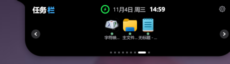
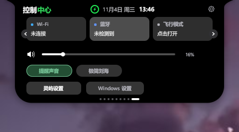
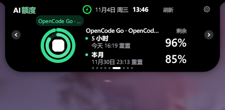

<div align="center">


# 灵屿 · LingYu

**桌面顶部的一条信息岛。**

Windows 桌面伙伴 · Dock 任务栏 · 控制中心 · 通知中枢 · AI 额度

[](LICENSE)
[](#安装)
[](https://www.rust-lang.org/)

</div>



| 控制中心 | AI 额度 |
| --- | --- |
|  |  |

| 通知 | 收起时 |
| --- | --- |
|  |  |

## 一条线，装下桌面上的事

灵屿常驻屏幕顶部。不打扰时它是一条细线；鼠标靠近，展开成一座小岛。窗口切换、消息提醒、额度余量、专注计时，都在这一条里。

用 Rust 与 egui 构建，单文件运行，不依赖 Electron，不需要登录。

## 能做什么

| 功能 | 说明 |
| --- | --- |
| Dock 任务栏 | 当前打开的窗口排成一行，点一下切过去；右键可最小化、关闭、固定；图标高清缓存，窗口变多自动加宽 |
| 控制中心 | Wi-Fi、蓝牙、飞行模式状态一眼可见；音量滑杆、静音；一键打开系统设置 |
| 通知中枢 | 接收 OpenCode 等编码工具的完成/失败事件，显示会话标题，点「查看」直接回到对应窗口 |
| AI 额度 | Codex、Claude、Kimi、Grok Bot、Gemini、OpenCode Go；5 小时与本月用量、重置时间、常驻圆环 |
| 桌面伙伴 | 会扫视、眨眼、打哈欠，也会惊讶、思考、害羞、犯困；跟着音乐一起晃 |
| Home 页 | 在设置里指定默认页；每次展开都回到这里，收起不迷路 |
| 音乐与歌词 | 读取 Windows 媒体会话，控制播放、切歌、进度；岛上单行歌词 |
| 专注与饮水 | 专注/休息计时、饮水目标与提醒时段，改设置立即生效 |
| 文件置物架 | 拖入临时收集，打开或定位原文件，拖出到其他应用 |
| 待办 | 添加、编辑、完成，支持日期与时间提醒 |
| 邮箱 | 多账号收信、验证码识别与复制、正文阅读 |
| 日程 | 月历与当日安排，合并工作日历与邮件邀请 |

## 安装

需要 Windows 10/11、Rust 1.80+ 和 Visual Studio Build Tools（C++ 桌面开发）。

```powershell
git clone https://github.com/jjlinjay/lingyu.git
cd lingyu
cargo build --release --bin lingyu
```

产物在 `target\release\lingyu.exe`，直接运行即可。也可以用 `installer\install.ps1` 安装到 `%LOCALAPPDATA%\Programs\LingYu` 并创建快捷方式。

## 卸载

运行 `installer\uninstall.ps1`，或删除 `%LOCALAPPDATA%\Programs\LingYu` 与 `%APPDATA%\LingYu`。

## 数据与隐私

设置、额度缓存、图标缓存都在 `%APPDATA%\LingYu`。邮箱授权码、日历密码只写入 Windows 凭据管理器，不落盘、不上传。灵屿没有账号体系，也不收集遥测。

## 许可

MIT，见 [LICENSE](LICENSE)。第三方依赖与素材声明见 [THIRD_PARTY_NOTICES.txt](THIRD_PARTY_NOTICES.txt)。
